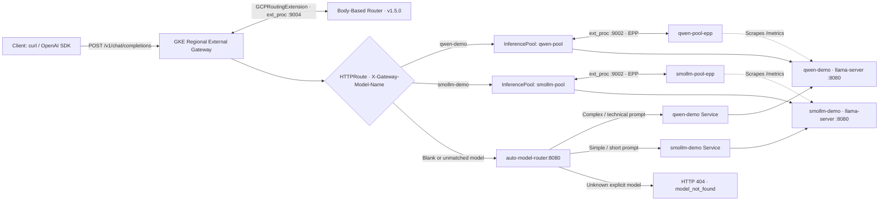
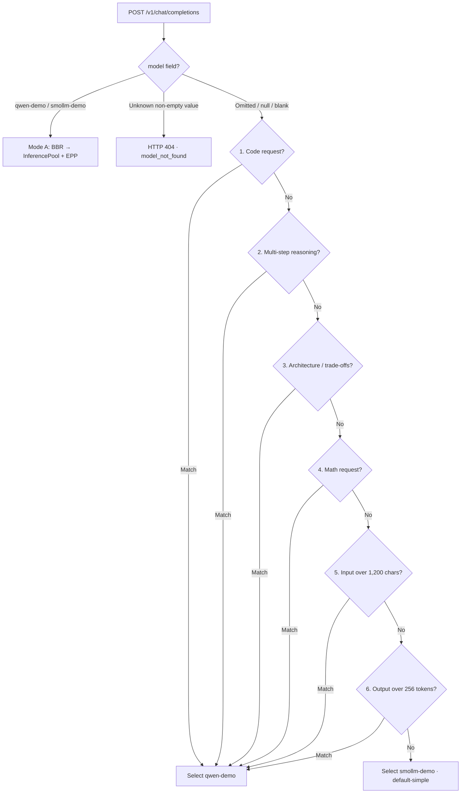

# GKE Inference Gateway CPU Demo

A CPU-only Google Kubernetes Engine (GKE) demo that serves two small GGUF language models behind one OpenAI-compatible endpoint. It combines explicit model routing through the [Gateway API Inference Extension](https://github.com/kubernetes-sigs/gateway-api-inference-extension) with deterministic, rule-based model selection when the request does not specify a model.

[](https://cloud.google.com/kubernetes-engine)
[](https://github.com/kubernetes-sigs/gateway-api-inference-extension)
[](https://huggingface.co)
[](https://github.com/ggml-org/llama.cpp)
[](router/classifier.py)
[](terraform/)
[](LICENSE)

**At a glance:** 100% CPU • one zonal GKE Standard node • two models • one public OpenAI-compatible endpoint • explicit and automatic routing • server-sent events (SSE) streaming

## Contents

- [Quick start](#quick-start)
- [Architecture and request flows](#architecture-and-request-flows)
- [Automatic routing logic](#automatic-routing-logic)
- [Environment and stack](#environment-and-stack)
- [Usage examples](#usage-examples)
- [Benchmarks and telemetry](#benchmarks-and-telemetry)
- [Documentation](#documentation)
- [Roadmap](#roadmap)
- [Cleanup](#cleanup)

## Quick start

### Prerequisites

Install and configure the following tools:

- `gcloud` with project access, Application Default Credentials (ADC)
- `kubectl`
- Helm `v3+`
- Terraform `>= 1.5`
- Python `>= 3.10`
- `jq` and `curl`

### Deploy and verify

Run the commands from the repository root:

```bash
# 1. Check local tools, authentication, project access, and billing
make preflight

# 2. Run local router unit and HTTP/SSE contract tests (no cluster required)
make test-classifier

# 3. Provision the VPC, proxy-only subnet, firewall, IAM, and GKE cluster
make infra

# 4. Deploy models, InferencePools, EPPs, routers, Gateway, and HTTPRoute
make deploy

# 5. Inspect pods, resource usage, InferencePools, and Gateway address
make status

# 6. Run end-to-end routing and streaming checks
make test
make test-auto-routing
make test-streaming

# 7. Collect Prometheus metrics and benchmark end-to-end performance
make metrics
make benchmark
```

After deployment, retrieve the public Gateway IP:

```bash
export GATEWAY_IP="$(kubectl get gateway inference-gateway -o jsonpath='{.status.addresses[0].value}')"
echo "http://${GATEWAY_IP}/v1/chat/completions"
```

The `make test-classifier` target runs 28 local tests. The end-to-end targets require the deployed cluster and a provisioned Gateway.

## Architecture and request flows

The MVP runs two `llama.cpp` model servers on a single `e2-standard-2` GKE node. Requests enter through a regional external GKE Gateway and use one of two routing paths:

- **Explicit model selection:** the Body-Based Router (BBR) extracts the request's `model` field. `HTTPRoute` directs supported model names to their `InferencePool`; the Endpoint Picker (EPP) selects a model endpoint using observed model-pod metrics.
- **Automatic model selection:** requests with an omitted or blank `model` field are forwarded to `auto-model-router`. Its ordered rule classifier chooses a model and proxies the request directly to that model's internal Kubernetes Service. Unknown non-empty model names return `HTTP 404 model_not_found`.

### End-to-end topology



### Routing modes

| Mode | Request behavior | Routing path | Model selection |
|---|---|---|---|
| **A — Explicit** | `model` is `qwen-demo` or `smollm-demo` | BBR → `HTTPRoute` → `InferencePool` → EPP → selected model pod | Client-selected model; EPP chooses an endpoint within its pool |
| **B — Automatic** | `model` is omitted, `null`, empty, or whitespace-only | `HTTPRoute` fallback → `auto-model-router` → model Service | Ordered, deterministic rule classifier |
| **Invalid model** | `model` contains an unsupported non-empty name | Fallback → `auto-model-router` → `HTTP 404` | Returns `model_not_found` |

For explicit routing, each EPP uses the `core-metrics-extractor` engine configuration to scrape `llama.cpp` `/metrics`, including `llamacpp:requests_deferred` and `llamacpp:requests_processing`, and perform model-aware endpoint selection.

## Automatic routing logic

The classifier in [`router/classifier.py`](router/classifier.py) evaluates non-system messages (`user`, `assistant`, and `tool`) and requested output-token limits. Rules are checked in priority order; the first match wins.



| Priority | `X-Auto-Route-Reason` | Selected model | Trigger summary |
|---:|---|---|---|
| 1 | `code-request` | `qwen-demo` | Fenced code blocks, inline code/SQL/Kubernetes/Terraform, or requests to write, debug, refactor, or review code and manifests |
| 2 | `reasoning-request` | `qwen-demo` | Multi-step reasoning requests, including phrases such as `step-by-step`, `first principles`, `formal proof`, or `logic puzzle` |
| 3 | `architecture-request` | `qwen-demo` | System design and trade-off analysis, including `pros and cons`, `CAP theorem`, or `root-cause analysis` |
| 4 | `math-request` | `qwen-demo` | Multi-operator expressions or math-solving requests such as `calculate`, `integral`, `derivative`, or `probability` |
| 5 | `long-input` | `qwen-demo` | Combined non-system message length is greater than `1200` characters (`AUTO_ROUTER_LONG_INPUT_CHARS`) |
| 6 | `large-output` | `qwen-demo` | `max_tokens` or `max_completion_tokens` is greater than `256` (`AUTO_ROUTER_LONG_OUTPUT_TOKENS`) |
| 7 | `default-simple` | `smollm-demo` | Default when rules 1–6 do not match, such as short questions, greetings, or brief explanations |

The router adds `X-Auto-Selected-Model` and `X-Auto-Route-Reason` response headers. It supports ordinary JSON responses and `stream: true` server-sent events (SSE). This is deterministic rule-based routing, not an LLM-based prompt classifier.

For more details, see [Architecture](docs/architecture.md), including the sequence diagram, Gateway API comparisons, CPU inference-engine analysis, and Terraform/controller resource ownership.

## Environment and stack

The values below describe the tested demo environment and are not required to be your own project settings.

| Property | Value |
|---|---|
| Gateway class | `gke-l7-regional-external-managed` |
| Gateway endpoint | `http://<GATEWAY_IP>/v1/chat/completions` |
| Model A — `qwen-demo` | `Qwen/Qwen2.5-0.5B-Instruct-GGUF` · `qwen2.5-0.5b-instruct-q4_k_m.gguf` · 468.6 MiB |
| Model B — `smollm-demo` | `HuggingFaceTB/SmolLM2-360M-Instruct-GGUF` · `smollm2-360m-instruct-q8_0.gguf` · 368.5 MiB |
| Inference engine | `llama.cpp` server with GGUF models |
| Auto-router container | `python:3.12-slim` · request: `25m CPU / 64Mi RAM` · observed usage: approximately `3m CPU / 19Mi RAM` |
| Gateway API Inference Extension | BBR and EPP `v1.5.0` |

## Usage examples

All examples use the public Gateway IP exported in the [Quick start](#quick-start) section.

### Explicit model selection

Send the request through the matching `InferencePool` and EPP:

```bash
# Explicitly route to qwen-demo
curl -sS "http://${GATEWAY_IP}/v1/chat/completions" \
  -H "Content-Type: application/json" \
  -d '{
    "model": "qwen-demo",
    "messages": [
      {"role": "system", "content": "You are a concise assistant."},
      {"role": "user", "content": "State your model family in one short sentence and name two planets."}
    ],
    "max_tokens": 64,
    "temperature": 0.1
  }' | jq .

# Explicitly route to smollm-demo
curl -sS "http://${GATEWAY_IP}/v1/chat/completions" \
  -H "Content-Type: application/json" \
  -d '{
    "model": "smollm-demo",
    "messages": [
      {"role": "user", "content": "Write one short sentence explaining what Kubernetes is."}
    ],
    "max_tokens": 64,
    "temperature": 0.1
  }' | jq .
```

### Automatic model selection

Omit `model` (or send it as an empty value) to invoke the rule-based classifier. Use `-i` to inspect the router's response headers.

```bash
# A simple prompt should select smollm-demo (default-simple)
curl -i -sS "http://${GATEWAY_IP}/v1/chat/completions" \
  -H "Content-Type: application/json" \
  -d '{
    "messages": [
      {"role": "user", "content": "What is the capital of France? Answer in one short sentence."}
    ],
    "max_tokens": 32,
    "temperature": 0.1
  }'

# A code prompt should select qwen-demo (code-request)
curl -i -sS "http://${GATEWAY_IP}/v1/chat/completions" \
  -H "Content-Type: application/json" \
  -d '{
    "messages": [
      {"role": "user", "content": "Write a Python function to check if a string is a palindrome."}
    ],
    "max_tokens": 64,
    "temperature": 0.1
  }'
```

Look for `X-Auto-Selected-Model` and `X-Auto-Route-Reason` in the response headers.

### Server-sent events (SSE) streaming

Set `stream` to `true` and use `curl -N` to display chunks as they arrive:

```bash
curl -i -N -sS "http://${GATEWAY_IP}/v1/chat/completions" \
  -H "Content-Type: application/json" \
  -d '{
    "messages": [
      {"role": "user", "content": "Write a short Python function that adds two numbers."}
    ],
    "max_tokens": 64,
    "temperature": 0.1,
    "stream": true
  }'
```

### OpenAI Python SDK

Install the SDK with `pip install openai`. Set `GATEWAY_IP` in your shell as shown in [Quick start](#quick-start), then run:

```python
import os
from openai import OpenAI

client = OpenAI(
    base_url=f"http://{os.environ['GATEWAY_IP']}/v1",
    api_key="unused-cpu-demo",
)

# Use "qwen-demo" or "smollm-demo" for explicit routing.
# An empty model value invokes automatic routing.
response = client.chat.completions.with_raw_response.create(
    model="",
    messages=[
        {"role": "user", "content": "Write a Python function to compute Fibonacci numbers."}
    ],
    max_tokens=64,
)

print("Selected model:", response.headers.get("x-auto-selected-model"))
print("Route reason:", response.headers.get("x-auto-route-reason"))
print(response.parse().choices[0].message.content)
```

See [Usage guide and API examples](docs/usage-and-examples.md) for all classifier triggers, `400`/`404` error examples, Node.js/TypeScript SDK snippets, structured JSON log inspection, and router environment variables.

## Benchmarks and telemetry

The results below were recorded end to end through the public GKE Regional External Application Load Balancer on one `e2-standard-2` node. They are demonstration measurements from small test batches, not production capacity guarantees.

### Non-streaming benchmark

`make benchmark` · `max_tokens=64`

| Model | Mode | Successful requests | p50 latency | p95 latency (estimated) | End-to-end throughput | Server decode throughput |
|---|---|---:|---:|---:|---:|---:|
| `qwen-demo` | Sequential (`N=5`) | 5/5 | **3.837 s** | 4.037 s | **15.47 tok/s** | **17.83 tok/s** |
| `qwen-demo` | Concurrent (`N=4`, `c=2`) | 4/4 | **6.885 s** | 7.391 s | **16.81 tok/s** | 9.33 tok/s |
| `smollm-demo` | Sequential (`N=5`) | 5/5 | **3.471 s** | 3.665 s | **18.47 tok/s** | **21.96 tok/s** |
| `smollm-demo` | Concurrent (`N=4`, `c=2`) | 4/4 | **5.694 s** | 5.980 s | **20.60 tok/s** | 11.70 tok/s |

### Streaming time to first token (TTFT)

`make test-streaming` · measured true TTFT, not just HTTP time to first byte (TTFB)

| Case | Request `model` | Resolved model | Route | True TTFT | Total stream time | Result |
|---|---|---|---|---:|---:|:---:|
| `explicit-qwen` | `qwen-demo` | `qwen-demo` | Explicit (`BBR → EPP`) | **0.7016 s** | 2.7212 s | PASS |
| `explicit-smollm` | `smollm-demo` | `smollm-demo` | Explicit (`BBR → EPP`) | **0.6416 s** | 1.9311 s | PASS |
| `auto-simple` | Omitted | `smollm-demo` | `default-simple` | **0.3859 s** | 2.2102 s | PASS |
| `auto-complex` | Omitted | `qwen-demo` | `code-request` | **0.7965 s** | 4.1942 s | PASS |


See [Benchmarks and metrics](docs/benchmarks-and-metrics.md) for the nine-case auto-routing verification matrix, Prometheus metrics (`llamacpp:*` and `inference_*`), TTFT versus TTFB, and analysis of parallel-slot sharing on 2 vCPUs.

## Documentation

| Document | What it covers |
|---|---|
| [Architecture decision record](docs/architecture.md) | End-to-end sequence, resource ownership, explicit versus automatic routing, `llama.cpp` versus `vLLM` on CPU, and security posture |
| [Usage guide and API examples](docs/usage-and-examples.md) | Request examples for each rule, SSE streaming, error responses, Python and TypeScript clients, and configuration reference |
| [Benchmarks and metrics](docs/benchmarks-and-metrics.md) | Auto-routing test matrix, latency and throughput results, Prometheus metrics, and TTFT/TTFB definitions |
| [Troubleshooting guide](docs/troubleshooting.md) | Diagnostics and fixes for Gateway, NEG health checks, BBR, EPP metrics authentication, and Terraform teardown |
| [Architectural roadmap](docs/roadmap.md) | Proposed approaches for routing automatic model selection through `InferencePool` and EPP |

## Roadmap

### Current MVP behavior

- **Mode A:** explicit supported `model` values use `InferencePool` and EPP for endpoint selection.
- **Mode B:** automatic classification occurs in `auto-model-router`, which sends requests directly to the selected internal model Service. This avoids recursively routing the request through the public Gateway.

## Cleanup

Destroy the Terraform-managed infrastructure when you finish testing:

```bash
make destroy
```