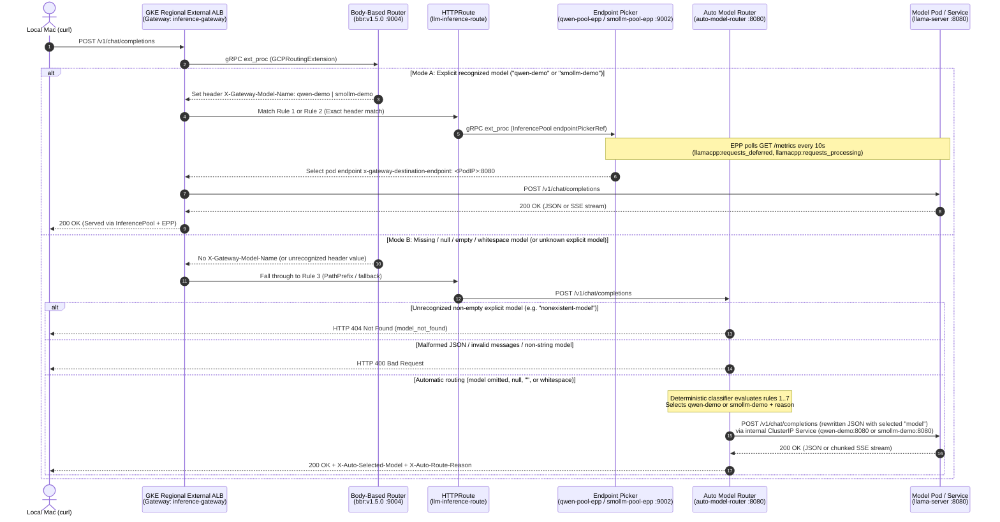
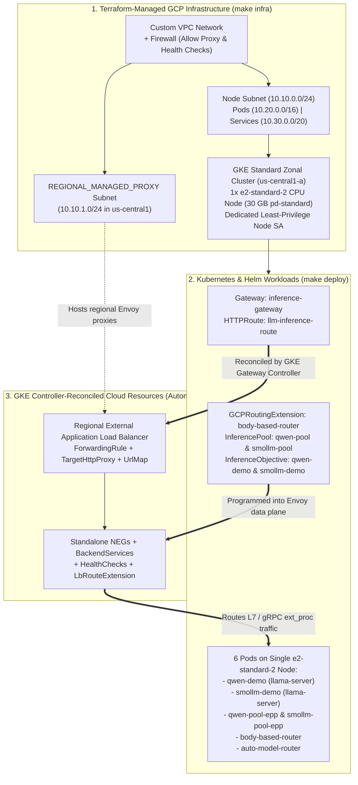

# Architecture Decision Record — GKE Inference Gateway CPU MVP

## 1. Executive Summary

This project implements a genuine, production-pattern **GKE Inference Gateway** running entirely on **a single CPU-only GKE Standard node**, serving two distinct open-weights instruction-tuned language models behind one public OpenAI-compatible `/v1/chat/completions` endpoint:

- **`qwen-demo`**: `Qwen/Qwen2.5-0.5B-Instruct-GGUF` (`qwen2.5-0.5b-instruct-q4_k_m.gguf`, ~468.6 MB)
- **`smollm-demo`**: `HuggingFaceTB/SmolLM2-360M-Instruct-GGUF` (`smollm2-360m-instruct-q8_0.gguf`, ~368.5 MiB)

Unlike a basic Kubernetes `Gateway` + `HTTPRoute` + `Service` demo, this architecture deploys the full **Gateway API Inference Extension (`v1.5.0`)** stack integrated with Google Cloud's regional external Application Load Balancer (`gke-l7-regional-external-managed`):

1. **`GCPRoutingExtension` + Body-Based Router (`bbr:v1.5.0`)**: Inspects the HTTP POST JSON payload via Envoy `ext_proc` before route evaluation and extracts the `"model"` field (when present and non-empty) into the `X-Gateway-Model-Name` and `x-gateway-inference-objective` headers.
2. **`HTTPRoute` (`llm-inference-route`) with Dual-Mode Precedence**:
   - **Mode A — Explicit Model Selection (Rules 1 & 2, higher specificity)**: Matches `X-Gateway-Model-Name: qwen-demo` or `X-Gateway-Model-Name: smollm-demo` and dispatches traffic to the corresponding `InferencePool` custom resource (`qwen-pool` or `smollm-pool`).
   - **Mode B — Automatic Model Selection & Fallback Validation (Rule 3, fallback path match)**: When `model` is omitted, `null`, empty `""`, whitespace-only, or an unrecognized string, the request falls through to the internal `Service/auto-model-router:8080`.
3. **`InferencePool` + `InferenceObjective` + Endpoint Picker (`epp:v1.5.0`) (Mode A)**: Each model pool runs a dedicated Endpoint Picker (`qwen-pool-epp` and `smollm-pool-epp`) that watches `InferenceObjective` priorities, continuously scrapes Prometheus `/metrics` from model server pods (`llamacpp:requests_deferred` and `llamacpp:requests_processing`), scores candidate pods using `queue-scorer`, `kv-cache-utilization-scorer`, and `prefix-cache-scorer`, and instructs the GKE load balancer which specific pod IP:port (`x-gateway-destination-endpoint`) should serve the request.
4. **Rule-Based Automatic Model Router (`auto-model-router`) (Mode B)**: A lightweight Python 3.12 service (`25m CPU / 64Mi RAM` request) that validates the OpenAI chat completions contract, rejects unrecognized non-empty explicit models with `HTTP 404` (`model_not_found`), and—when `model` is omitted, `null`, empty, or whitespace-only—applies an explainable, deterministic rule hierarchy over the non-system messages and `max_tokens`/`max_completion_tokens` to select either `qwen-demo` (complex/technical) or `smollm-demo` (simple/short default). It injects the selected `model` into the JSON payload, attaches `X-Auto-Selected-Model`, `X-Auto-Route-Reason`, and `X-Auto-Route-Mode` response headers, and forwards the request (including chunked SSE `"stream": true` responses) directly to the internal `ClusterIP` model `Service` (`qwen-demo:8080` or `smollm-demo:8080`).

---

## 2. End-to-End Request Flow (Mode A Explicit vs. Mode B Automatic)



---

## 3. Genuine GKE Inference Gateway vs. Ordinary Gateway API Routing

| Capability | Ordinary Gateway API (`Gateway` + `HTTPRoute` + `Service`) | This MVP (Genuine GKE Inference Gateway `v1.5.0` + Auto Model Router) |
| :--- | :--- | :--- |
| **JSON Body `"model"` Routing** | Not supported natively (`HTTPRoute` can only match path, query params, or client-supplied HTTP headers). | Supported via `GCPRoutingExtension` + `body-based-router` (`ext_proc`) extracting JSON `.model` into `X-Gateway-Model-Name`. |
| **Automatic Model Selection (Missing `"model"`)** | Not supported. | Fallback `HTTPRoute` rule routes missing/blank `model` requests to `auto-model-router`, which deterministically classifies prompt complexity and sets `X-Auto-Selected-Model` + `X-Auto-Route-Reason`. |
| **Backend Abstraction** | Standard Kubernetes `Service` (`ClusterIP` / `NodePort`). | **Mode A (Explicit)**: `InferencePool` (`inference.networking.k8s.io/v1`) + `InferenceObjective` (`inference.networking.x-k8s.io/v1alpha2`).<br/>**Mode B (Auto)**: `auto-model-router` forwarding to internal `ClusterIP` model `Service`s (`qwen-demo:8080`, `smollm-demo:8080`). |
| **Load Balancing Strategy** | Round-robin / connection-based L7 load balancing blind to LLM queue depth or token generation state. | **Mode A (Explicit)**: Model-aware scheduling via Endpoint Picker (`epp:v1.5.0`) using real-time queue depth (`queue-scorer`), KV cache utilization, and prefix cache affinity.<br/>**Mode B (Auto)**: Deterministic complexity routing to the right model tier (`qwen-demo` vs. `smollm-demo`) via internal `ClusterIP` Service. |
| **Telemetry Scraping** | None at the routing layer. | `epp` scrapes `/metrics` from each model pod via `metrics-data-source` and `core-metrics-extractor`. |
| **Priority & Admission Control** | None. | `InferenceObjective` defines workload priority (`priority: 10`) enforced by EPP's admission and flow-control layer on explicit routes. |

---

## 3.1 Deterministic Automatic Model Selection Architecture (`router/`)

### Why `HTTPRoute` Fallback + Direct Internal `ClusterIP` Forwarding?

In Gateway API, a route rule matching both a header (`X-Gateway-Model-Name: qwen-demo` or `smollm-demo`) and path (`PathPrefix: /`) has strictly higher precedence than a rule matching only `PathPrefix: /`.

1. **Zero interference with Mode A (Explicit routing)**: Any request carrying `"model": "qwen-demo"` or `"model": "smollm-demo"` is tagged by `body-based-router` with `X-Gateway-Model-Name` and matches Rule 1 or Rule 2 of `HTTPRoute/llm-inference-route`. It goes straight to `InferencePool/qwen-pool` or `InferencePool/smollm-pool` and their Endpoint Pickers (`qwen-pool-epp`, `smollm-pool-epp`), never touching `auto-model-router`.
2. **No second load balancer or recursive Gateway hair-pinning**: When `model` is omitted or blank, `body-based-router` leaves `X-Gateway-Model-Name` unset, and the request matches Rule 3 (`Service/auto-model-router:8080`). After `auto-model-router` classifies the request and injects `"model": "qwen-demo"` or `"model": "smollm-demo"`, it forwards directly to the internal Kubernetes `ClusterIP` service (`http://qwen-demo.default.svc.cluster.local:8080` or `http://smollm-demo.default.svc.cluster.local:8080`) rather than re-entering the public Gateway IP.
   - **Trade-off**: Automatic requests bypass the `InferencePool` / `Endpoint Picker` layer and go directly from `auto-model-router` to the internal model `Service` (so EPP request counters increment only on Mode A explicit requests, while `llama-server` Prometheus metrics increment on both Mode A and Mode B requests). In a single-replica-per-model CPU setup, direct `ClusterIP` forwarding avoids extra Envoy hairpin latency and prevents recursive loop risks.

### Deterministic Rule Hierarchy (`router/classifier.py`)

Only non-`system` messages (`user`, `assistant`, `tool`, etc.) are concatenated for keyword and length inspection so a verbose system prompt does not falsely trigger complex routing on a trivial user greeting. Rules are evaluated in strict top-down order; the first matching rule wins:

| Priority | Reason Code (`X-Auto-Route-Reason`) | Selected Model (`X-Auto-Selected-Model`) | Deterministic Trigger Condition |
| :---: | :--- | :--- | :--- |
| **1** | `code-request` | `qwen-demo` | Markdown code fence (`` ``` ``) or programming/devops keywords (`python`, `golang`, `go`, `javascript`, `typescript`, `sql`, `bash`, `yaml`, `json`, `dockerfile`, `terraform`, `kubernetes`, `manifest`, `function`, `class`, `method`, `regex`, `script`, `code`, `implement`, `refactor`, `debug`, `stack trace`, `compile`, `unit test`, `bug`, `exception`, `syntax`). |
| **2** | `reasoning-request` | `qwen-demo` | Multi-step analytical keywords (`compare`, `comparison`, `trade-off`, `tradeoff`, `pros and cons`, `step-by-step`, `step by step`, `analyze`, `analysis`, `evaluate`, `critique`, `contrast`, `why does`, `how does`, `explain in detail`, `in-depth`, `comprehensive`, `differentiate`, `implications`). |
| **3** | `architecture-request` | `qwen-demo` | Systems/cloud design keywords (`architecture`, `system design`, `design pattern`, `distributed system`, `microservices`, `scalability`, `high availability`, `fault tolerance`, `load balancer`, `consensus`, `cap theorem`, `database schema`, `data model`, `pipeline`, `infrastructure`, `production-ready`, `topology`, `latency budget`, `throughput`). |
| **4** | `math-request` | `qwen-demo` | Quantitative/algorithmic keywords (`calculate`, `equation`, `formula`, `derivative`, `integral`, `probability`, `statistics`, `linear algebra`, `matrix`, `theorem`, `proof`, `algorithm`, `complexity`, `big-o`, `big o`, `time complexity`, `space complexity`, `optimize`, `optimization`, `solve for`). |
| **5** | `long-input` | `qwen-demo` | Total character length of non-system message content `> AUTO_ROUTER_LONG_INPUT_CHARS` (default: **`1200`** characters). |
| **6** | `large-output` | `qwen-demo` | Requested `max_tokens` or `max_completion_tokens` `> AUTO_ROUTER_LONG_OUTPUT_TOKENS` (default: **`256`** tokens). |
| **7** | `default-simple` | `smollm-demo` | Default fallback when none of Rules 1–6 match (short, simple questions, greetings, brief summaries). |

### Limitations of Rule-Based Routing

- **Lexical vs. semantic understanding**: Because the classifier uses fast, zero-cost regex and threshold rules (~0.1 ms CPU time, zero external dependencies), a prompt containing a technical keyword in a trivial context (e.g., *"Spell the word algorithm"*) will route to `qwen-demo` (`math-request`), whereas a subtle riddle phrased entirely in everyday vocabulary without keywords and under 1,200 characters will route to `smollm-demo` (`default-simple`).
- **Why this is the right trade-off for a CPU MVP**: Running an embedding model or LLM router on CPU would add 100–500 ms of latency and 300+ MiB of RAM on our constrained `e2-standard-2` node, whereas deterministic rules are 100% reproducible, explainable via `X-Auto-Route-Reason`, and require ~18 MiB of RAM.

---

## 4. Component Selection & Trade-Off Analysis

### 4.1 Model Server: `llama.cpp` (`llama-server`) vs. `vLLM` CPU

| Criterion | `llama.cpp` (`ghcr.io/ggml-org/llama.cpp:server`) | `vLLM` CPU (`vllm-cpu-release-repo`) | Winner for Cheapest CPU MVP |
| :--- | :--- | :--- | :--- |
| **Compressed Image Size** | **~297 MB** (`linux/amd64`) | ~2.8 – 4.0 GB | **`llama.cpp`** (~10x smaller) |
| **Runtime Memory per Model** | **~500 – 650 MiB** (with `--ctx-size 2048 --parallel 2`) | ~3.5 – 6.0 GiB (PyTorch + Python + KV cache pre-allocation) | **`llama.cpp`** (fits 2 models on 1 `e2-standard-2` node) |
| **Cold Startup Time** | **1 – 2 seconds** once GGUF is on disk | 45 – 120 seconds (PyTorch import + CPU kernel compilation) | **`llama.cpp`** |
| **OpenAI API Compatibility** | Native `/v1/chat/completions`, `/v1/models`, `/health` | Native `/v1/chat/completions`, `/v1/models`, `/health` | Tie |
| **EPP `/metrics` Integration** | Exposes Prometheus `/metrics` (`llamacpp:requests_deferred`, `llamacpp:requests_processing`) mapped natively via EPP `v1.5.0` `core-metrics-extractor` `engineConfigs`. | Exposes `vllm:num_requests_waiting`, `vllm:num_requests_running`, `vllm:kv_cache_usage_perc`. | Tie (with EPP `v1.5.0` `engineConfigs`) |

**Key Engineering Discovery (`EPP v1.5.0` + `llama.cpp`):**
In `gateway-api-inference-extension` `v1.5.0`, the Endpoint Picker's `core-metrics-extractor` plugin introduced `engineConfigs` support (`pkg/epp/framework/plugins/datalayer/extractor/metrics/factories.go`). By configuring `defaultEngine: llamacpp` with:
- `queuedRequestsSpec: "llamacpp:requests_deferred"`
- `runningRequestsSpec: "llamacpp:requests_processing"`

and enabling `--metrics` on `llama-server`, EPP natively scrapes and extracts real-time queue and active-request metrics from `llama.cpp` pods without any missing-metric errors or fallback degradation.

### 4.2 Language Models Selected

1. **`qwen-demo` — `Qwen/Qwen2.5-0.5B-Instruct-GGUF` (`qwen2.5-0.5b-instruct-q4_k_m.gguf`)**
   - **Parameters**: 490M (Qwen2.5 architecture by Alibaba Cloud, Apache-2.0 license).
   - **Download size**: 491,400,032 bytes (~468.6 MiB), unauthenticated public download from Hugging Face.
   - **Characteristics**: Fast instruction-following model with strong structured output and distinct Qwen identity.
2. **`smollm-demo` — `HuggingFaceTB/SmolLM2-360M-Instruct-GGUF` (`smollm2-360m-instruct-q8_0.gguf`)**
   - **Parameters**: 360M (SmolLM2 architecture by Hugging Face TB, Apache-2.0 license).
   - **Download size**: 386,404,992 bytes (~368.5 MiB), unauthenticated public download from Hugging Face.
   - **Characteristics**: Ultra-compact model quantized at 8-bit (`Q8_0`) for crisp short-form answers at minimal RAM cost.

Both models use an `initContainer` (`download-model`) sharing the exact same pinned `ghcr.io/ggml-org/llama.cpp:server@sha256:fc9b506e89c1a1cfdd7bc056480f54dc657c1c04d76839a08642dc280b8ed2f6` image to download the GGUF file into an `emptyDir` volume before `llama-server` starts. This avoids pulling a second downloader image and separates network download latency from server readiness probes.

### 4.3 GKE Mode, Machine Type, and Resource Sizing

- **GKE Standard Single-Zone (`us-central1-a`) vs. GKE Autopilot**:
  - GKE Standard allows running a single `e2-standard-2` node (`2 vCPU`, `8 GB RAM`, ~$48.92/mo list price) with a `30 GB pd-standard` boot disk ($1.20/mo) and **Google Cloud Managed Service for Prometheus disabled** (`managed_prometheus.enabled = false`).
  - Furthermore, theupstream `inferencepool:v1.5.0` Helm chart defaults to `requests: { cpu: "4", memory: 8Gi }` per EPP pod — which on Autopilot would automatically bill for 8+ vCPUs and 16+ GiB RAM across two pools unless overridden, and Autopilot enforces minimum pod resource floors and higher per-vCPU/GB pod pricing.
- **Why `e2-standard-2` instead of `e2-medium`?**
  - `e2-medium` provides only `940m` allocatable CPU on GKE (1 shared core). After GKE `kube-system` pods reserve ~550m CPU, less than `390m` CPU remains for all user workloads combined, and shared-core throttling causes slow token generation and probe timeouts when running 2 model servers + 2 EPPs + 1 BBR + 1 auto-model-router.
  - `e2-standard-2` provides `1930m` allocatable CPU and `~6.1 GiB` allocatable RAM. Our 6 application pods (`qwen-demo`, `smollm-demo`, `qwen-pool-epp`, `smollm-pool-epp`, `body-based-router`, and `auto-model-router`) request a combined **675m CPU** and **1856Mi RAM** (`auto-model-router` requests `25m CPU / 64Mi RAM` and uses `~3m CPU / ~19Mi RAM` at runtime), fitting comfortably on a single `e2-standard-2` node with plenty of CPU burst headroom (`1500m` limit per model pod) for fast CPU token generation.

### 4.4 Outbound Connectivity & Security Posture (No Cloud NAT)

- **Design**: The single GKE node resides in a custom VPC subnet (`10.10.0.0/24`) with an ephemeral external IPv4 address ($0.005/hr = ~$3.65/mo), avoiding Cloud NAT + Cloud Router gateway charges (~$32+/mo).
- **Security Implications**:
  - In a custom VPC network, GCP's implied deny-all ingress firewall rule blocks all unsolicited inbound connections from the internet to the node's external IP.
  - Only the explicit `google_compute_firewall.allow_proxy_and_health_checks` rule permits TCP ingress on ports `8080, 9002, 9003, 9004, 9005` from the regional Envoy proxy-only subnet (`10.10.1.0/24`) and Google Cloud health check ranges (`130.211.0.0/22`, `35.191.0.0/16`).
  - Workload Identity (`GKE_METADATA`), Shielded GKE Nodes (`enable_secure_boot = true`, `enable_integrity_monitoring = true`), and a dedicated least-privilege node Service Account (`gke-inference-gw-cpu-node-sa`) are enforced.
  - Model `Service` objects (`qwen-demo`, `smollm-demo`) and extension/routing `Service` objects (`qwen-pool-epp`, `smollm-pool-epp`, `body-based-router`, `auto-model-router`) are `ClusterIP` (internal only). Only the `Gateway` (`inference-gateway`) exposes a public HTTP endpoint.

---

## 5. Terraform vs. Controller-Managed Resource Ownership



| Resource Layer | Owner | Lifecycle |
| :--- | :--- | :--- |
| Project APIs, VPC, Node Subnet, `REGIONAL_MANAGED_PROXY` Subnet, Firewall Rules, Node Service Account, IAM Bindings, GKE Cluster, CPU Node Pool | **Terraform** (`terraform/*.tf`, local state) | Created via `make infra` (`terraform apply`), destroyed via `make destroy` (`terraform destroy`). |
| Kubernetes CRDs, Model `Deployment`s/`Service`s, `InferencePool`s, `InferenceObjective`s, EPP & BBR `Deployment`s, `auto-model-router`, `Gateway`, `HTTPRoute`, `GCPRoutingExtension`, `GCPBackendPolicy`, `HealthCheckPolicy` | **Kubernetes / Helm** (`scripts/deploy.sh`) | Created via `make deploy`. |
| GCP Regional External Application Load Balancer (`ForwardingRule`, `TargetHttpProxy`, `UrlMap`, `BackendService`s, `HealthCheck`s, `NetworkEndpointGroup`s, `ServiceLbPolicy`, `LbRouteExtension`) | **GKE Gateway & Inference Controllers** | Automatically reconciled when `Gateway`, `HTTPRoute`, `InferencePool`, and `GCPRoutingExtension` are applied in Kubernetes. **Never create or mutate these via `gcloud` or Terraform.** Before running `terraform destroy`, delete the Kubernetes `Gateway` (`make destroy` handles this automatically) so the GKE controller releases the VPC's proxy-only subnet and forwarding rules cleanly. |

---

## 6. Related Documentation

- **[Usage Guide & API Examples](usage-and-examples.md)** — `curl`, SSE streaming, error handling, and OpenAI Python/TypeScript SDK examples.
- **[Benchmarks, Streaming TTFT & Metrics](benchmarks-and-metrics.md)** — Live E2E latency/throughput benchmarks, True TTFT vs. HTTP TTFB, and Prometheus telemetry.
- **[Troubleshooting Guide](troubleshooting.md)** — Diagnostic commands and common failure resolutions.
- **[Architectural Roadmap](roadmap.md)** — Proposed Phase 1 (Gateway Re-entry) and Phase 2 (Single-Pass Custom IPP) unification with `InferencePool` & EPP.
