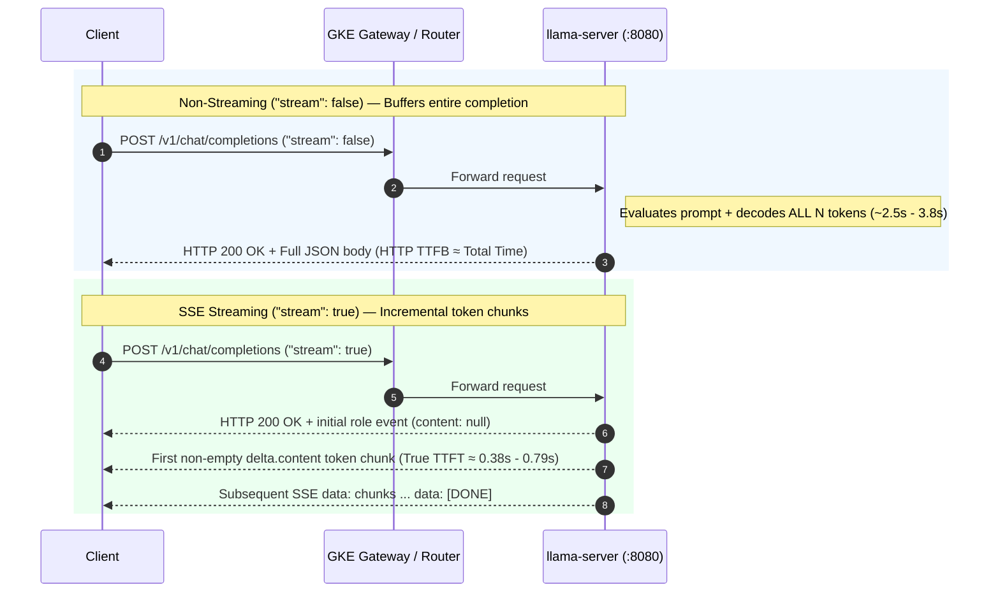

# Benchmarks, Streaming TTFT & Prometheus Telemetry

This document records the live end-to-end verification, SSE streaming Time-to-First-Token (TTFT), latency/throughput benchmarks, and Prometheus metrics collected from the **GKE Inference Gateway CPU MVP** running on a single `e2-standard-2` (`2 vCPU`, `8 GB RAM`) node in `us-central1-a`.

---

## 1. Automated Verification Commands

| Makefile Target | Script | Purpose | Local Artifact Output |
| :--- | :--- | :--- | :--- |
| `make test-classifier` | `router/test_router.py` | 28-case table-driven unit & HTTP/SSE contract tests (no cluster required) | Terminal output |
| `make test` | `scripts/test-e2e.sh` | Live E2E test for explicit `qwen-demo`, `smollm-demo`, and `HTTP 404` unknown model | Terminal output |
| `make test-auto-routing` | `scripts/test-auto-routing.sh` | 9-case live E2E test suite covering Mode A explicit precedence, Mode B auto-routing, and `400`/`404` errors | `.results/auto-routing/<timestamp>/` |
| `make test-streaming` | `scripts/test-streaming.sh` | Verifies SSE (`"stream": true`) and measures true TTFT across explicit and automatic routes | `.results/streaming/<timestamp>/` |
| `make metrics` | `scripts/collect-metrics.sh` | Scrapes and summarizes Prometheus `/metrics` from both model pods and Endpoint Pickers | `.results/metrics/<timestamp>/` |
| `make benchmark` | `scripts/benchmark.sh` | Runs sequential (`N=5`) and bounded concurrent (`N=4`, `c=2`) E2E benchmarks with pre/post metric deltas | `.results/benchmark/<timestamp>/` |

---

## 2. Live Auto-Routing Verification Matrix (`make test-auto-routing`)

Observed live test run against `http://35.209.207.194/v1/chat/completions` (`.results/auto-routing/20261011-212314/summary.md`):

| Test Case | Request `model` Field | Expected Route / Model | HTTP Status | Response `.model` | `X-Auto-Selected-Model` | `X-Auto-Route-Reason` | Latency (s) | Result |
| :--- | :--- | :--- | :---: | :--- | :--- | :--- | ---: | :---: |
| `1_explicit_qwen` | `"qwen-demo"` | Explicit Mode A (`InferencePool/qwen-pool`) | `200` | `qwen-demo` | `<none (explicit BBR->EPP path)>` | `<none>` | 2.617s | **PASS** |
| `2_explicit_smollm` | `"smollm-demo"` (with Go code prompt) | Explicit Mode A (`InferencePool/smollm-pool`) | `200` | `smollm-demo` | `<none (explicit BBR->EPP path)>` | `<none>` | 2.913s | **PASS** |
| `3_auto_simple_omitted_model` | `<omitted>` | Auto Mode B -> `smollm-demo` | `200` | `smollm-demo` | `smollm-demo` | `default-simple` | 1.950s | **PASS** |
| `4_auto_code_omitted_model` | `<omitted>` | Auto Mode B -> `qwen-demo` | `200` | `qwen-demo` | `qwen-demo` | `code-request` | 4.277s | **PASS** |
| `5_auto_architecture_omitted_model` | `<omitted>` | Auto Mode B -> `qwen-demo` | `200` | `qwen-demo` | `qwen-demo` | `architecture-request` | 4.300s | **PASS** |
| `6_auto_long_input_omitted_model` | `<omitted>` (`1398` chars) | Auto Mode B -> `qwen-demo` | `200` | `qwen-demo` | `qwen-demo` | `long-input` | 6.450s | **PASS** |
| `7_auto_whitespace_model` | `"   "` | Auto Mode B -> `smollm-demo` | `200` | `smollm-demo` | `smollm-demo` | `default-simple` | 1.637s | **PASS** |
| `8_unknown_explicit_model_404` | `"nonexistent-model"` | Reject (`HTTP 404`) | `404` | `<error>` | `<none>` | `<none>` | 0.367s | **PASS** |
| `9_malformed_request_400` | `12345` (non-string) | Reject (`HTTP 400`) | `400` | `<error>` | `<none>` | `<none>` | 0.338s | **PASS** |

---

## 3. Streaming Inference (`stream: true` SSE) & True TTFT (`make test-streaming`)

### 3.1 Non-Streaming HTTP First-Byte Time vs. True Streaming TTFT



- **Non-Streaming HTTP TTFB (`curl` `time_starttransfer` with `"stream": false`)**: When `"stream": false`, `llama-server` buffers the entire generated completion until the final token is decoded, then serializes and sends the single JSON response. Consequently, `curl`'s `time_starttransfer` is virtually identical to `time_total` and measures **total generation time**, **not** Time-to-First-Token.
- **SSE Role Event vs. True TTFT (`"stream": true`)**: When `"stream": true`, `llama-server` sends HTTP response headers (`Content-Type: text/event-stream`) and an initial SSE event containing `delta: {"role": "assistant", "content": null}` before or just as token generation begins. `scripts/test-streaming.sh` (`make test-streaming`) incrementally parses the incoming SSE stream and records **True TTFT** only when the **first non-empty `choices[0].delta.content` token chunk** arrives.

### 3.2 Observed Streaming Results (`.results/streaming/20261011T212623Z/summary.md`)

| Case | Request Model | HTTP Status | Returned Model | Auto Selected Header | Auto Reason Header | True TTFT (s) | Total Stream (s) | Content Chunks | `[DONE]` Received | Status |
| :--- | :--- | :---: | :--- | :--- | :--- | ---: | ---: | ---: | :---: | :---: |
| `explicit-qwen` | `"qwen-demo"` | `200` | `qwen-demo` | `-` | `-` | **0.7016s** | **2.7212s** | 32 | `True` | **PASS** |
| `explicit-smollm` | `"smollm-demo"` | `200` | `smollm-demo` | `-` | `-` | **0.6416s** | **1.9311s** | 32 | `True` | **PASS** |
| `auto-simple` | `<omitted>` | `200` | `smollm-demo` | `smollm-demo` | `default-simple` | **0.3859s** | **2.2102s** | 32 | `True` | **PASS** |
| `auto-complex` | `<omitted>` | `200` | `qwen-demo` | `qwen-demo` | `code-request` | **0.7965s** | **4.1942s** | 64 | `True` | **PASS** |

---

## 4. End-to-End Inference Benchmark (`make benchmark`)

`scripts/benchmark.sh` (`make benchmark`) runs a conservative, reproducible benchmark through the **public GKE Gateway** (`http://35.209.207.194/v1/chat/completions`), never bypassing the Gateway or Body-Based Router:
- `1` warm-up request per model (recorded in `requests.csv` as `mode=warmup`, excluded from summary statistics).
- `5` sequential measured requests per model (`max_tokens=64`, `temperature=0.0`).
- `4` bounded concurrent measured requests per model at `concurrency=2`.
- Pre- and post-benchmark Prometheus metrics snapshots via `scripts/collect-metrics.sh` to verify exact EPP and model server counter increments.

### 4.1 Observed Benchmark Summary (`.results/benchmark/20261011-212720/summary.md`)

| Model | Mode | OK / Total | HTTP Err | p50 Latency | p95 Latency (est.) | Avg Latency | Avg HTTP TTFB | Wall Time | Observed RPS | End-to-End Tok/s | Server Decode Tok/s |
| :--- | :--- | ---: | ---: | ---: | ---: | ---: | ---: | ---: | ---: | ---: | ---: |
| `qwen-demo` | `sequential` | 5/5 | 0 | **3.837s** | 4.037s | 3.701s | 3.701s | 19.39s | 0.26 req/s | **15.47 tok/s** | **17.83 tok/s** |
| `qwen-demo` | `concurrent` (c=2) | 4/4 | 0 | **6.885s** | 7.391s | 6.645s | 6.645s | 14.04s | 0.28 req/s | **16.81 tok/s** | 9.33 tok/s |
| `smollm-demo` | `sequential` | 5/5 | 0 | **3.471s** | 3.665s | 3.168s | 3.167s | 16.56s | 0.30 req/s | **18.47 tok/s** | **21.96 tok/s** |
| `smollm-demo` | `concurrent` (c=2) | 4/4 | 0 | **5.694s** | 5.980s | 5.524s | 5.524s | 11.74s | 0.34 req/s | **20.60 tok/s** | 11.70 tok/s |

### 4.2 Server & EPP Counter Deltas Across the Benchmark Run

| Metric Delta (`Post - Pre`) | `qwen-demo` / `qwen-pool-epp` | `smollm-demo` / `smollm-pool-epp` |
| :--- | ---: | ---: |
| `+ inference_objective_request_total` (EPP) | `+10` (1 warmup + 5 seq + 4 conc) | `+10` (1 warmup + 5 seq + 4 conc) |
| `+ llamacpp:prompt_tokens_total` | `+29` | `+31` |
| `+ llamacpp:tokens_predicted_total` | `+600` | `+612` |

### 4.3 Caveats for Interpreting CPU Benchmark Numbers on a Single `e2-standard-2` Node

1. **Preliminary Small-Sample Percentiles**: `p95 Latency (est.)` is computed over `N=5` sequential and `N=4` concurrent requests per model to keep CPU test runs fast (~60s total) and should be treated as a preliminary small-sample estimate.
2. **Shared 2-vCPU Node Contention**: All six inference pods (`qwen-demo`, `smollm-demo`, `qwen-pool-epp`, `smollm-pool-epp`, `body-based-router`, and `auto-model-router`) plus GKE system daemons share a single `e2-standard-2` VM (`2 vCPU`, `8 GB RAM`).
3. **Parallel Slot Sharing (`--parallel 2`, `--threads 2`)**: Each `llama-server` pod is configured with `2` active KV slots (`--parallel 2`) and `2` CPU threads (`--threads 2`). When `concurrency=2` sends two simultaneous requests to the same model, both slots decode in parallel (`llamacpp:n_busy_slots_per_decode` rises to `~1.17`) and share the 2 vCPUs. Per-request decode speed halves (`17.83 -> 9.33 tok/s` for Qwen; `21.96 -> 11.70 tok/s` for SmolLM) and per-request wall latency increases by ~1.5x–1.8x, while aggregate end-to-end throughput increases (`15.47 -> 16.81 tok/s` for Qwen; `18.47 -> 20.60 tok/s` for SmolLM) with zero errors or pod restarts.

---

## 5. Lightweight Model & Endpoint Picker Metrics (`make metrics`)

`scripts/collect-metrics.sh` (`make metrics`) scrapes Prometheus metrics directly from all four internal services via temporary local `kubectl port-forward` sessions (cleaned up automatically via `trap`) without deploying a separate Prometheus or Grafana stack:
- `svc/qwen-demo:8080/metrics` -> `.results/metrics/<timestamp>/qwen.metrics`
- `svc/smollm-demo:8080/metrics` -> `.results/metrics/<timestamp>/smollm.metrics`
- `svc/qwen-pool-epp:9090/metrics` -> `.results/metrics/<timestamp>/qwen-epp.metrics`
- `svc/smollm-pool-epp:9090/metrics` -> `.results/metrics/<timestamp>/smollm-epp.metrics`

> **EPP Metrics Authentication Note**: By default, the `inferencepool:v1.5.0` Helm chart enables kube-rbac-proxy style token authentication (`--metrics-endpoint-auth=true`) on `:9090/metrics`. Because `qwen-pool-epp` and `smollm-pool-epp` are internal-only `ClusterIP` services in this single-node demo, `k8s/inference/qwen-pool-values.yaml` and `k8s/inference/smollm-pool-values.yaml` set `inferenceExtension.monitoring.prometheus.auth.enabled: false` (`--metrics-endpoint-auth=false`) so lightweight local scrapes work without RBAC bearer tokens or `ServiceMonitor` CRDs.

### 5.1 `llama.cpp` Model Server Metrics (`:8080/metrics`)

| Metric (`llamacpp:*`) | `qwen-demo` (Qwen2.5-0.5B) | `smollm-demo` (SmolLM2-360M) | Description |
| :--- | ---: | ---: | :--- |
| `prompt_tokens_total` | 199 | 210 | Cumulative non-cached prompt tokens evaluated |
| `prompt_tokens_cached_total` | 643 | 592 | Cumulative prompt tokens reused from LCP prefix cache |
| `tokens_predicted_total` | 738 | 832 | Cumulative generated (completion) tokens |
| `prompt_seconds_total` | 4.649s | 3.250s | Cumulative prompt evaluation time |
| `tokens_predicted_seconds_total` | 48.630s | 42.087s | Cumulative token generation (decode) time |
| Derived `prompt_tokens_total / prompt_seconds_total` | 42.80 tok/s | 64.62 tok/s | Cumulative average prompt evaluation throughput |
| Derived `tokens_predicted_total / tokens_predicted_seconds_total` | 15.18 tok/s | 19.77 tok/s | Cumulative average token generation (decode) throughput |
| `requests_processing` | 0 | 0 | Active requests currently processing (instantaneous gauge) |
| `requests_deferred` | 0 | 0 | Queued/deferred requests waiting for a slot |
| `n_decode_total` | 630 | 720 | Total `llama_decode()` forward-pass calls |
| `n_busy_slots_per_decode` | 1.17 | 1.16 | Average busy parallel slots per decode step |
| `n_tokens_max` | 107 | 109 | Largest observed sequence length (prompt + completion) |

### 5.2 Endpoint Picker (EPP) Metrics (`:9090/metrics`)

| Metric (`inference_*`) | `qwen-pool-epp` | `smollm-pool-epp` | Description |
| :--- | ---: | ---: | :--- |
| `inference_extension_info` (`build_ref`) | `v1.5.0` | `v1.5.0` | Gateway API Inference Extension build version |
| `inference_pool_ready_pods` | 1 | 1 | Ready model server pods in the `InferencePool` |
| `inference_extension_scheduler_attempts_total` | 14 | 14 | Total successful EPP pod scheduling decisions |
| `inference_extension_scheduler_e2e_duration_seconds` (avg) | 0.066 ms | 0.059 ms | Mean EPP end-to-end scheduling latency |
| `inference_objective_request_total` | 14 | 14 | Total requests routed through this `InferencePool` |
| `inference_objective_request_error_total` | 0 | 0 | Total errored requests observed by EPP |
| `inference_objective_running_requests` | 0 | 0 | In-flight requests currently tracked by EPP |
| `inference_objective_request_duration_seconds` (avg) | 3.390s (n=14) | 2.795s (n=14) | Mean end-to-end request duration observed by EPP |
| `inference_objective_input_tokens_sum` | 520 | 538 | Cumulative input tokens observed by EPP (non-streaming responses) |
| `inference_objective_output_tokens_sum` | 612 | 654 | Cumulative output tokens observed by EPP (non-streaming responses) |
| `inference_objective_normalized_time_per_output_token_seconds` (avg) | 71.45 ms/tok | 54.49 ms/tok | Mean normalized time per output token observed by EPP |
| `inference_objective_response_sizes_sum` | 20018 B | 20292 B | Cumulative HTTP response payload size in bytes |
| `inference_pool_average_running_requests` | 0.00 | 0.00 | Pool average running requests scraped from backends |
| `inference_pool_average_queue_size` | 0.00 | 0.00 | Pool average waiting queue size |
| `inference_pool_average_kv_cache_utilization` | 0.0000 | 0.0000 | Pool average KV cache utilization metric (vLLM-format gauge) |

---

## 6. Runtime Resource Utilization (`kubectl top`)

Observed steady-state resource consumption on the single `e2-standard-2` node:

```text
NAME                                                  CPU(cores)   CPU(%)   MEMORY(bytes)   MEMORY(%)
gke-gke-inference-gw-cpu-inference-po-65912ca6-734d   177m         9%       2199Mi          36%

NAME                                 CPU(cores)   MEMORY(bytes)
auto-model-router-695455b68d-86h6n   3m           19Mi
body-based-router-9ddf4cff-q78n9     2m           12Mi
qwen-demo-645c89c448-dhvfn           15m          203Mi
qwen-pool-epp-7bf666cf74-9j5kf       26m          16Mi
smollm-demo-66f4fd9699-hts8w         16m          189Mi
smollm-pool-epp-974976477-6gz8v      25m          18Mi
```
