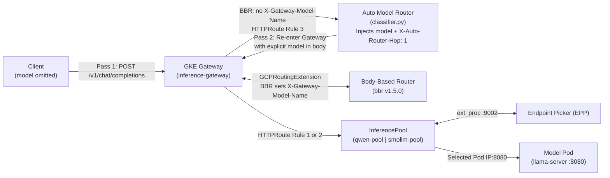
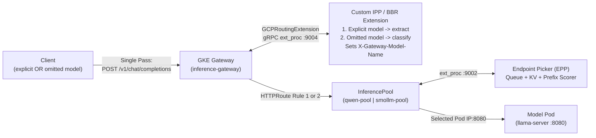

# Architectural Roadmap — Unifying Auto-Routing with `InferencePool` & EPP

> **Status — Proposed Future Improvements Only**: Everything in this document describes **proposed architectural evolutions, not implemented or verified capabilities**. None of the phases below have been deployed or tested against the live cluster.

---

## 1. Current Behavior & Architectural Objective

In the current MVP implementation:
- **Mode A (Explicit model selection)** routes requests carrying `"model": "qwen-demo"` or `"model": "smollm-demo"` through `body-based-router` (`bbr:v1.5.0` via `GCPRoutingExtension`), matches `X-Gateway-Model-Name` on `HTTPRoute/llm-inference-route` (Rules 1 & 2), and dispatches to `InferencePool/qwen-pool` or `InferencePool/smollm-pool` and their Endpoint Pickers (`qwen-pool-epp`, `smollm-pool-epp`).
- **Mode B (Automatic model selection)** falls through `HTTPRoute` Rule 3 (`PathPrefix: /`) to `Service/auto-model-router:8080` whenever `"model"` is omitted, `null`, empty `""`, or whitespace-only. `router/classifier.py` selects `qwen-demo` or `smollm-demo` deterministically and injects `"model"` into the JSON payload, and `router/server.py` forwards directly to the internal `ClusterIP` model `Service` (`http://qwen-demo.default.svc.cluster.local:8080` or `http://smollm-demo.default.svc.cluster.local:8080`).
- **Current limitation**: Because Mode B forwards directly from `auto-model-router` to the internal `ClusterIP` model `Service`s rather than routing through `InferencePool` and `Endpoint Picker (EPP)`, automatically selected requests bypass EPP's queue/KV-cache/prefix-cache scoring, `InferenceObjective` admission priority, and EPP request counters (`inference_objective_request_total` increments only on Mode A explicit requests, while `llamacpp:*` model server metrics increment on both Mode A and Mode B).

The architectural objective for future work is to unify automatic model selection with the inference-aware scheduling path while preserving all existing guarantees:
- Keep the existing deterministic rule-based classifier (`router/classifier.py`) responsible for choosing the model (`qwen-demo` vs. `smollm-demo`).
- Keep **GKE Inference Gateway** (`Gateway/inference-gateway` and `HTTPRoute/llm-inference-route`) responsible for routing requests to the appropriate model pool (`qwen-pool` or `smollm-pool`).
- Keep **Endpoint Picker (EPP)** (`qwen-pool-epp` and `smollm-pool-epp`) responsible for selecting an appropriate model-server replica within that pool.
- Preserve existing explicit-model request precedence and behavior (Mode A).
- Maintain a **single public inference endpoint** (`/v1/chat/completions`) and the current low-cost, CPU-only single-node (`e2-standard-2`) architecture wherever practical.

---

## 2. Phase 1 — Validate Gateway Re-entry (Proof of Concept)

*Status: Proposed, unverified proof of concept (not implemented or tested in production).*

### Proposed Request Flow

1. A client sends a `POST /v1/chat/completions` request without a `model` field (or with a blank/null `model`) to the existing public Gateway (`Gateway/inference-gateway`).
2. The current Body-Based Router (`bbr:v1.5.0`) leaves `X-Gateway-Model-Name` unset, and `HTTPRoute/llm-inference-route` (Rule 3 fallback) forwards the request to `Service/auto-model-router:8080`.
3. The rule-based classifier (`router/classifier.py`) evaluates the prompt and token budget, selects `qwen-demo` or `smollm-demo`, and injects the selected `"model"` identifier into the JSON request body.
4. Instead of forwarding directly to the model's internal `ClusterIP` `Service` (`qwen-demo:8080` or `smollm-demo:8080`), `auto-model-router` sends a second HTTP request to the **same public Gateway endpoint** (`http://<GATEWAY_IP>/v1/chat/completions`).
5. The second request includes the selected `"model"` identifier (`"qwen-demo"` or `"smollm-demo"`) in its JSON body.
6. On this second pass, the existing Body-Based Routing extension (`bbr:v1.5.0` via `GCPRoutingExtension`) extracts the `"model"` field into `X-Gateway-Model-Name` (and `x-gateway-inference-objective`).
7. The existing `HTTPRoute` (`llm-inference-route` Rule 1 or Rule 2) matches `X-Gateway-Model-Name` and selects the corresponding `InferencePool` (`qwen-pool` or `smollm-pool`).
8. The corresponding Endpoint Picker (`qwen-pool-epp` or `smollm-pool-epp`) scores candidate pods and selects a model-server endpoint (`x-gateway-destination-endpoint`).
9. The upstream response—including chunked SSE streaming (`"stream": true`) when requested—returns through `auto-model-router` (which attaches `X-Auto-Selected-Model`, `X-Auto-Route-Reason`, and `X-Auto-Route-Mode: auto`) back to the original client.

### Why This Approach Is Attractive

- **Preserves the current classifier implementation**: Reuses `router/classifier.py` and `router/server.py` with minimal changes (updating upstream target configuration and adding loop-prevention guards).
- **Reuses existing `InferencePool` and EPP routing paths**: Automatically selected requests traverse the exact same `GCPRoutingExtension` -> `HTTPRoute` -> `InferencePool` -> `EPP` path as explicit requests.
- **No additional public endpoints**: Avoids creating a second `Gateway`, external `LoadBalancer` `Service`, or extra cloud load-balancing resources.
- **Smallest validation step**: Provides a low-effort proof of concept to verify end-to-end EPP scheduling and metrics on auto-routed traffic before investing in custom Envoy `ext_proc` extensions.

### Trade-Offs and Open Questions

- **Second Gateway traversal overhead**: Hair-pinning automatically selected requests through the external Regional Application Load Balancer and `body-based-router` a second time introduces extra network hops, CPU overhead, and request latency.
- **Recursive routing loop prevention**: The router must strictly prevent accidental infinite loops—for example, if a re-entered request ever failed to receive an `X-Gateway-Model-Name` header matching Rule 1 or Rule 2, `HTTPRoute` Rule 3 would route it back into `auto-model-router`. A hop-guard header (such as `X-Auto-Router-Hop: 1`) and strict model-name validation before forwarding are mandatory.
- **In-cluster reachability to the public Gateway VIP**: Reachability from the `auto-model-router` pod inside the cluster to the public `gke-l7-regional-external-managed` Gateway IP must be verified against GKE dataplane routing, node egress rules, and VPC firewall configuration.
- **Gateway IP discovery and lifecycle**: Because the Gateway's external IP is dynamically assigned unless a static regional IP is reserved, `auto-model-router` must handle Gateway IP discovery and potential IP changes cleanly rather than relying on fragile hardcoded addresses.
- **End-to-end protocol fidelity**: SSE streaming (`"stream": true` chunked passthrough and TTFT), nested timeout budgets (`AUTO_ROUTER_UPSTREAM_TIMEOUT_SEC` inside `GCPBackendPolicy` `timeoutSec: 120`), response headers (`X-Auto-Selected-Model`, `X-Auto-Route-Reason`), error handling, and `HTTP 404` unknown-model responses must remain reliable across two Gateway passes.
- **EPP telemetry verification**: EPP Prometheus counters (`inference_objective_request_total` and `inference_extension_scheduler_attempts_total`) must be inspected before and after test runs to confirm that automatically selected requests genuinely traverse the `InferencePool`/EPP path.

---

## 3. Phase 2 — Single-Pass Routing with a Custom Inference Payload Processor

*Status: Proposed longer-term architectural investigation (requires feasibility and compatibility research).*

### Proposed Request Flow

1. A client sends a `POST /v1/chat/completions` request to the existing public Gateway (`Gateway/inference-gateway`).
2. A pre-routing extension attached to the Gateway examines the request payload before `HTTPRoute` backend selection.
3. When no explicit `model` is supplied (or when `model` is `null`, empty, or whitespace-only), a deterministic rule-based classifier evaluates the prompt and token budget in-line.
4. The selected model identifier (`qwen-demo` or `smollm-demo`) is written into the request routing metadata (`X-Gateway-Model-Name` and `x-gateway-inference-objective` headers, and optionally into the JSON `"model"` body field) for the Gateway's route-selection mechanism.
5. The Gateway evaluates `HTTPRoute/llm-inference-route` in a **single pass** and selects the corresponding `InferencePool` (`qwen-pool` or `smollm-pool`).
6. The existing Endpoint Picker (`qwen-pool-epp` or `smollm-pool-epp`) selects a model-server replica within that pool.

This architecture would eliminate the second Gateway traversal while preserving the project's deterministic classification policy and single public endpoint.

### Role of GKE Inference Gateway, Gateway API Inference Extension, and `llm-d` Components

- **`llm-d` Inference Payload Processor (IPP) & Body-Based Router (`bbr`)**:
  - Within the [Gateway API Inference Extension](https://github.com/kubernetes-sigs/gateway-api-inference-extension) and [llm-d](https://github.com/llm-d/llm-d) ecosystems, the pre-routing Envoy external processor (`ext_proc`) originated as the **Body-Based Router (BBR)** (`registry.k8s.io/gateway-api-inference-extension/bbr:v1.5.0` in this deployment) and has evolved under `llm-d` as the pluggable **Inference Payload Processor (IPP)**.
  - **Configuration boundary**: The standard `bbr:v1.5.0` deployment used in this repository (`k8s/inference/bbr-values.yaml`) only supports built-in extraction/mapping plugins (`body-field-to-header` and `base-model-to-header`). It **does not** support arbitrary prompt-complexity classification rules through YAML configuration alone.
- **GKE `GCPRoutingExtension`**:
  - On GKE (`gke-l7-regional-external-managed`), `GCPRoutingExtension` (`networking.gke.io/v1`) hooks the regional Application Load Balancer's Envoy data plane to an in-cluster gRPC `ext_proc` service (currently `Service/body-based-router:9004`) prior to `HTTPRoute` matching.
- **Custom IPP Plugins or Request-Processing Extensions**:
  - Implementing single-pass rule-based classification requires either:
    1. Developing a **custom IPP / BBR plugin** (in Go) compiled into a custom processor image that runs the deterministic classification rules whenever the JSON `"model"` field is absent or blank, or
    2. Implementing a **custom gRPC `ext_proc` routing extension** (or chaining extensions if supported by `GCPRoutingExtension`) that performs both explicit `"model"` extraction and fallback rule-based complexity classification.
- **`HTTPRoute` Selection & Model-Name Header Convention**:
  - Because `HTTPRoute/llm-inference-route` already routes on `X-Gateway-Model-Name: qwen-demo` (Rule 1 -> `qwen-pool`) and `X-Gateway-Model-Name: smollm-demo` (Rule 2 -> `smollm-pool`), any pre-routing `ext_proc` extension that populates `X-Gateway-Model-Name` (and `x-gateway-inference-objective`) allows the Gateway to dispatch both Mode A (explicit) and Mode B (auto-classified) requests directly to the target `InferencePool` in a single pass.
  - **Open investigation items**: Determining how response headers (`X-Auto-Selected-Model`, `X-Auto-Route-Reason`, `X-Auto-Route-Mode`) and `HTTP 404` (`model_not_found`) responses for unknown explicit models should be emitted (either via `ext_proc` response-header/immediate-response mutations or via `HTTPRoute` Rule 3 fallback to a lightweight error handler).
- **Likely Implementation Requirements**:
  - Custom extension or IPP plugin development that ports and maintains 100% rule parity with `router/classifier.py`.
  - Building, publishing, and maintaining a custom `linux/amd64` container image and Kubernetes/Helm deployment manifests within the single-node CPU/memory budget.
  - End-to-end compatibility and regression testing with GKE's `GCPRoutingExtension` `ext_proc` implementation.

### Official Reference Starting Points

- [About GKE Inference Gateway](https://docs.cloud.google.com/kubernetes-engine/docs/concepts/about-gke-inference-gateway)
- [Serve an LLM with GKE Inference Gateway](https://docs.cloud.google.com/kubernetes-engine/docs/how-to/serve-with-gke-inference-gateway)
- [Kubernetes SIGs — Gateway API Inference Extension](https://github.com/kubernetes-sigs/gateway-api-inference-extension)
- [llm-d — Kubernetes-native Distributed LLM Inference](https://github.com/llm-d/llm-d)

---

## 4. Phase 3 — Comparison of Proposed Approaches

The table below summarizes the **expected architectural trade-offs** (not measured performance results) between Phase 1 and Phase 2:

| Criterion | Phase 1: Gateway Re-entry | Phase 2: Custom IPP / Extension |
| :--- | :--- | :--- |
| Reuses current Python classifier | Yes | Policy can be preserved, implementation may move |
| Single Gateway traversal | No | Target architecture |
| Existing `InferencePool` / EPP path | Re-entered through the Gateway | Used directly through normal route selection |
| Implementation complexity | Lower initial effort | Higher engineering effort |
| Additional request latency | Expected | Expected to be lower than re-entry, subject to testing |
| Custom extension / image | Not necessarily | Likely required |
| Status | Proposed, unverified | Proposed, requires compatibility research |

> **Why Direct Calls to the EPP Port Are Not a Substitute**: `auto-model-router` cannot simply forward HTTP `/v1/chat/completions` requests directly to `qwen-pool-epp:9002` or `smollm-pool-epp:9002`. The Endpoint Picker (EPP) is not an HTTP model-proxy endpoint; it is an Envoy `ext_proc` gRPC endpoint-selection service that participates in the Gateway's endpoint-selection protocol (returning scheduling metadata such as `x-gateway-destination-endpoint` to the GKE Gateway data plane, which then forwards the HTTP request to the chosen model pod IP).

---

## 5. Acceptance Criteria for Future Implementation

Before either roadmap phase is considered complete, all of the following verification checks must pass against the live cluster without committing to predetermined numerical latency targets prior to testing:

- [ ] **Explicit `qwen-demo` preservation**: Requests with `"model": "qwen-demo"` retain their current Mode A behavior and precedence.
- [ ] **Explicit `smollm-demo` preservation**: Requests with `"model": "smollm-demo"` retain their current Mode A behavior and precedence (even when the prompt contains complex/code keywords).
- [ ] **Deterministic automatic classification**: Requests without `"model"` (or with `null`, `""`, or whitespace-only `"model"`) select the intended model (`qwen-demo` or `smollm-demo`) based on the existing classifier rules (`make test-classifier` and `make test-auto-routing`).
- [ ] **Unknown model rejection**: Unrecognized, explicitly supplied model names (e.g., `"nonexistent-model"`) still return `HTTP 404` (`model_not_found`).
- [ ] **InferencePool & EPP traversal on automatic routes**: Both automatically selected paths (`qwen-demo` and `smollm-demo`) traverse their corresponding `InferencePool` (`qwen-pool`, `smollm-pool`) and Endpoint Picker (`qwen-pool-epp`, `smollm-pool-epp`).
- [ ] **Telemetry & log confirmation**: EPP Prometheus request metrics (`inference_objective_request_total`, `inference_extension_scheduler_attempts_total` via `make metrics`) and prompt-safe structured logs confirm that automatic requests traverse the `InferencePool`/EPP path.
- [ ] **SSE streaming parity**: Existing streaming verification tests (`make test-streaming`) continue to pass for both explicit and automatically routed requests.
- [ ] **Pre- and post-integration benchmarking**: End-to-end benchmark results (`make benchmark`) are collected before and after integration to quantify any latency and throughput impact.
- [ ] **No extra infrastructure sprawl**: No additional GKE cluster, node, GPU, TPU, public endpoint, or cloud load balancer is introduced unless separately justified.
- [ ] **Resource & cost transparency**: Existing single-node CPU resource constraints (`e2-standard-2`) and operational cost estimates remain accurately documented.
