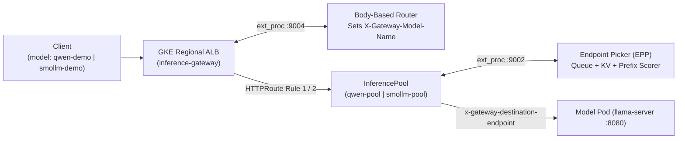
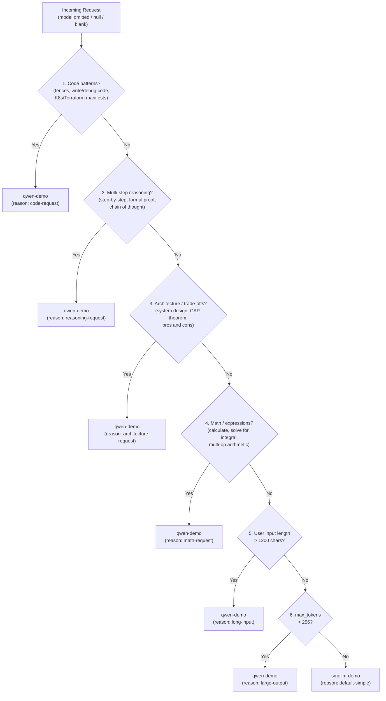

# Usage Guide & API Examples

This guide provides copy-pasteable examples for interacting with the **GKE Inference Gateway CPU MVP** (`POST /v1/chat/completions`) using `curl`, the official OpenAI Python SDK, and the OpenAI Node.js/TypeScript SDK.

---

## 1. Endpoint Discovery

After deploying the stack (`make infra && make deploy`), resolve the public IP address assigned to `Gateway/inference-gateway`:

```bash
export GATEWAY_IP="$(kubectl get gateway inference-gateway -o jsonpath='{.status.addresses[0].value}')"
echo "Endpoint: http://${GATEWAY_IP}/v1/chat/completions"
```

---

## 2. Mode A — Explicit Model Selection (`InferencePool` + `EPP`)

When you pass a recognized `"model"` name (`"qwen-demo"` or `"smollm-demo"`), the **Body-Based Router (`bbr:v1.5.0`)** extracts `"model"` into the `X-Gateway-Model-Name` header via `GCPRoutingExtension`, and `HTTPRoute/llm-inference-route` dispatches the request directly to the corresponding **`InferencePool`** and **Endpoint Picker (`epp:v1.5.0`)**.



### 2.1 Explicit Request to `qwen-demo` (`Qwen2.5-0.5B-Instruct`)

```bash
curl -i -s "http://${GATEWAY_IP}/v1/chat/completions" \
  -H "Content-Type: application/json" \
  -d '{
    "model": "qwen-demo",
    "messages": [
      {"role": "system", "content": "You are a concise assistant."},
      {"role": "user", "content": "State your model family in one short sentence and name two planets."}
    ],
    "max_tokens": 64,
    "temperature": 0.1
  }'
```

**Sample Verified Response (`HTTP 200 OK`):**
```json
{
  "choices": [
    {
      "finish_reason": "stop",
      "index": 0,
      "message": {
        "role": "assistant",
        "content": "Model family: AI\nTwo planets: Earth, Mars"
      }
    }
  ],
  "created": 1791750802,
  "model": "qwen-demo",
  "object": "chat.completion",
  "usage": {
    "completion_tokens": 12,
    "prompt_tokens": 32,
    "total_tokens": 44,
    "prompt_tokens_details": {
      "cached_tokens": 31
    }
  }
}
```

### 2.2 Explicit Request to `smollm-demo` (`SmolLM2-360M-Instruct`)

```bash
curl -i -s "http://${GATEWAY_IP}/v1/chat/completions" \
  -H "Content-Type: application/json" \
  -d '{
    "model": "smollm-demo",
    "messages": [
      {"role": "system", "content": "You are a concise assistant."},
      {"role": "user", "content": "Write one short sentence explaining what Kubernetes is."}
    ],
    "max_tokens": 64,
    "temperature": 0.1
  }'
```

### 2.3 Explicit Precedence Over Complex Prompts

Explicitly specifying `"model": "smollm-demo"` **always takes precedence** over prompt complexity. Even if the prompt asks for code or system architecture, `HTTPRoute` Rule 2 routes directly to `InferencePool/smollm-pool` without invoking `auto-model-router`:

```bash
curl -i -s "http://${GATEWAY_IP}/v1/chat/completions" \
  -H "Content-Type: application/json" \
  -d '{
    "model": "smollm-demo",
    "messages": [
      {"role": "user", "content": "Write a Go function that reverses a slice of integers."}
    ],
    "max_tokens": 64,
    "temperature": 0.1
  }'
```

---

## 3. Mode B — Deterministic Automatic Model Selection (`auto-model-router`)

When `"model"` is **omitted**, `null`, empty `""`, or whitespace-only `"   "`, `HTTPRoute/llm-inference-route` falls through to Rule 3 (`Service/auto-model-router:8080`). The router evaluates non-system messages against 7 deterministic rules, injects the chosen `"model"` into the JSON payload, and returns diagnostic headers:
- `X-Auto-Selected-Model`: `qwen-demo` or `smollm-demo`
- `X-Auto-Route-Reason`: `code-request`, `reasoning-request`, `architecture-request`, `math-request`, `long-input`, `large-output`, or `default-simple`
- `X-Auto-Route-Mode`: `auto`
- `X-Request-Id`: Correlation UUID



### 3.1 Simple Prompt -> Routes to `smollm-demo` (`default-simple`)

```bash
curl -i -s "http://${GATEWAY_IP}/v1/chat/completions" \
  -H "Content-Type: application/json" \
  -d '{
    "messages": [
      {"role": "user", "content": "What is the capital of France? Answer in one short sentence."}
    ],
    "max_tokens": 32,
    "temperature": 0.1
  }'
```

**Response Headers:**
```http
HTTP/1.1 200 OK
X-Auto-Selected-Model: smollm-demo
X-Auto-Route-Reason: default-simple
X-Auto-Route-Mode: auto
```

### 3.2 Code Generation / Debugging Prompt -> Routes to `qwen-demo` (`code-request`)

```bash
curl -i -s "http://${GATEWAY_IP}/v1/chat/completions" \
  -H "Content-Type: application/json" \
  -d '{
    "messages": [
      {"role": "user", "content": "Write a Python function to check if a string is a palindrome."}
    ],
    "max_tokens": 64,
    "temperature": 0.1
  }'
```

**Response Headers:**
```http
HTTP/1.1 200 OK
X-Auto-Selected-Model: qwen-demo
X-Auto-Route-Reason: code-request
X-Auto-Route-Mode: auto
```

### 3.3 Step-by-Step Reasoning Prompt -> Routes to `qwen-demo` (`reasoning-request`)

```bash
curl -i -s "http://${GATEWAY_IP}/v1/chat/completions" \
  -H "Content-Type: application/json" \
  -d '{
    "messages": [
      {"role": "user", "content": "Explain step by step how TCP three-way handshakes establish a connection."}
    ],
    "max_tokens": 96,
    "temperature": 0.1
  }'
```

### 3.4 Architecture & Trade-Off Prompt -> Routes to `qwen-demo` (`architecture-request`)

```bash
curl -i -s "http://${GATEWAY_IP}/v1/chat/completions" \
  -H "Content-Type: application/json" \
  -d '{
    "messages": [
      {"role": "user", "content": "Compare the architecture and trade-offs of regional vs zonal Kubernetes clusters."}
    ],
    "max_tokens": 96,
    "temperature": 0.1
  }'
```

### 3.5 Mathematical Prompt -> Routes to `qwen-demo` (`math-request`)

```bash
curl -i -s "http://${GATEWAY_IP}/v1/chat/completions" \
  -H "Content-Type: application/json" \
  -d '{
    "messages": [
      {"role": "user", "content": "Calculate (18 * 14) + 48 and show the result."}
    ],
    "max_tokens": 48,
    "temperature": 0.1
  }'
```

### 3.6 Large Output Budget (`max_tokens > 256`) -> Routes to `qwen-demo` (`large-output`)

```bash
curl -i -s "http://${GATEWAY_IP}/v1/chat/completions" \
  -H "Content-Type: application/json" \
  -d '{
    "messages": [
      {"role": "user", "content": "Write a comprehensive guide to container security."}
    ],
    "max_tokens": 300,
    "temperature": 0.2
  }'
```

---

## 4. Server-Sent Events (SSE) Streaming (`"stream": true`)

Both Mode A (explicit) and Mode B (automatic) support full OpenAI-compatible Server-Sent Events (`text/event-stream`) streaming.

### 4.1 Explicit Streaming (`Mode A`)

```bash
curl -N -sS "http://${GATEWAY_IP}/v1/chat/completions" \
  -H "Content-Type: application/json" \
  -d '{
    "model": "qwen-demo",
    "messages": [
      {"role": "user", "content": "Explain Kubernetes in two short sentences."}
    ],
    "max_tokens": 64,
    "temperature": 0.1,
    "stream": true
  }'
```

### 4.2 Automatic Routing + SSE Streaming (`Mode B`)

```bash
curl -i -N -sS "http://${GATEWAY_IP}/v1/chat/completions" \
  -H "Content-Type: application/json" \
  -d '{
    "messages": [
      {"role": "user", "content": "Write a short Python function that adds two numbers."}
    ],
    "max_tokens": 64,
    "temperature": 0.1,
    "stream": true
  }'
```

---

## 5. Error Handling & Request Validation

### 5.1 Unknown Explicit Model (`HTTP 404 Not Found`)

```bash
curl -i -s "http://${GATEWAY_IP}/v1/chat/completions" \
  -H "Content-Type: application/json" \
  -d '{
    "model": "nonexistent-model",
    "messages": [{"role": "user", "content": "Hello"}],
    "max_tokens": 16
  }'
```

**Response (`HTTP 404 Not Found`):**
```json
{
  "error": {
    "message": "Model 'nonexistent-model' does not exist. Recognized models: qwen-demo, smollm-demo.",
    "type": "not_found_error",
    "code": "model_not_found"
  }
}
```

### 5.2 Malformed Request Payload (`HTTP 400 Bad Request`)

```bash
curl -i -s "http://${GATEWAY_IP}/v1/chat/completions" \
  -H "Content-Type: application/json" \
  -d '{
    "model": 12345,
    "messages": [{"role": "user", "content": "Hello"}]
  }'
```

**Response (`HTTP 400 Bad Request`):**
```json
{
  "error": {
    "message": "Field 'model' must be a string or null when provided.",
    "type": "invalid_request_error",
    "code": "invalid_model_type"
  }
}
```

---

## 6. OpenAI SDK Client Examples

Because the Gateway exposes a standard `/v1/chat/completions` endpoint, you can use the official OpenAI SDKs by setting `base_url` to `http://${GATEWAY_IP}/v1`.

### 6.1 Python (`openai` SDK)

```python
import os
from openai import OpenAI

gateway_ip = os.environ["GATEWAY_IP"]
client = OpenAI(
    base_url=f"http://{gateway_ip}/v1",
    api_key="unused-cpu-demo",  # No API key required for the demo endpoint
)

# 1. Mode A: Explicit model selection (routes via InferencePool + EPP)
explicit_resp = client.chat.completions.create(
    model="qwen-demo",
    messages=[{"role": "user", "content": "Name two benefits of Kubernetes."}],
    max_tokens=64,
    temperature=0.1,
)
print("Explicit model:", explicit_resp.model)
print("Content:", explicit_resp.choices[0].message.content)

# 2. Mode B: Automatic model selection (pass empty string "" to trigger auto-model-router)
auto_raw = client.chat.completions.with_raw_response.create(
    model="",
    messages=[{"role": "user", "content": "Write a Python function to compute Fibonacci numbers."}],
    max_tokens=96,
    temperature=0.1,
)
print("Auto-selected model:", auto_raw.headers.get("x-auto-selected-model"))
print("Auto-route reason:", auto_raw.headers.get("x-auto-route-reason"))
print("Content:", auto_raw.parse().choices[0].message.content)
```

### 6.2 Node.js / TypeScript (`openai` SDK)

```typescript
import OpenAI from "openai";

const client = new OpenAI({
  baseURL: `http://${process.env.GATEWAY_IP}/v1`,
  apiKey: "unused-cpu-demo",
});

async function main() {
  // Mode B: Automatic model routing with SSE streaming
  const { data: stream, response } = await client.chat.completions
    .create({
      model: "",
      messages: [{ role: "user", content: "What is the capital of Japan?" }],
      max_tokens: 32,
      stream: true,
    })
    .withResponse();

  console.log("Selected Model:", response.headers.get("x-auto-selected-model"));
  console.log("Route Reason:", response.headers.get("x-auto-route-reason"));

  for await (const chunk of stream) {
    process.stdout.write(chunk.choices[0]?.delta?.content || "");
  }
  console.log();
}

main();
```

---

## 7. Inspecting Router Logs & Tuning Thresholds

### 7.1 Prompt-Safe Structured Logs

`auto-model-router` emits single-line JSON logs to `stdout` without logging user prompts or model completions:

```bash
kubectl logs deployment/auto-model-router --tail=20
```

Example log entry:
```json
{
  "ts": "2026-10-11T21:23:18.412903Z",
  "level": "info",
  "msg": "routed chat completion request",
  "request_id": "a7d2c8d1-5f44-4d0e-9b1c-8f30e24b19a2",
  "mode": "auto",
  "selected_model": "qwen-demo",
  "reason": "code-request",
  "stream": false,
  "user_input_chars": 62,
  "requested_max_tokens": 64,
  "upstream": "qwen-demo.default.svc.cluster.local:8080",
  "status": 200,
  "response_bytes": 742,
  "duration_ms": 4271.14
}
```

### 7.2 Environment Variables (`Deployment/auto-model-router`)

| Variable | Default | Description |
| :--- | :--- | :--- |
| `AUTO_ROUTER_LONG_INPUT_CHARS` | `1200` | Non-system character count threshold that triggers `long-input` -> `qwen-demo` |
| `AUTO_ROUTER_LONG_OUTPUT_TOKENS` | `256` | `max_tokens` / `max_completion_tokens` threshold that triggers `large-output` -> `qwen-demo` |
| `AUTO_ROUTER_MAX_BODY_BYTES` | `65536` | Maximum allowed HTTP request body size in bytes (`64 KiB`) |
| `AUTO_ROUTER_MAX_MESSAGES` | `64` | Maximum allowed items in the `messages` array |
| `AUTO_ROUTER_MAX_TOKENS_LIMIT` | `4096` | Maximum allowed `max_tokens` / `max_completion_tokens` value |
| `AUTO_ROUTER_UPSTREAM_TIMEOUT_SEC` | `90` | Upstream socket timeout (seconds) when forwarding to model services |
| `AUTO_ROUTER_QWEN_UPSTREAM` | `http://qwen-demo.default.svc.cluster.local:8080` | Internal upstream URL for `qwen-demo` |
| `AUTO_ROUTER_SMOLLM_UPSTREAM` | `http://smollm-demo.default.svc.cluster.local:8080` | Internal upstream URL for `smollm-demo` |
